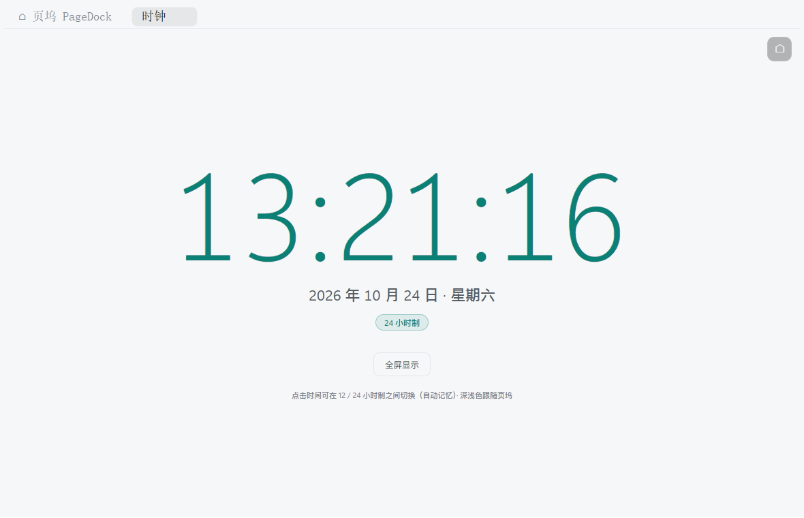
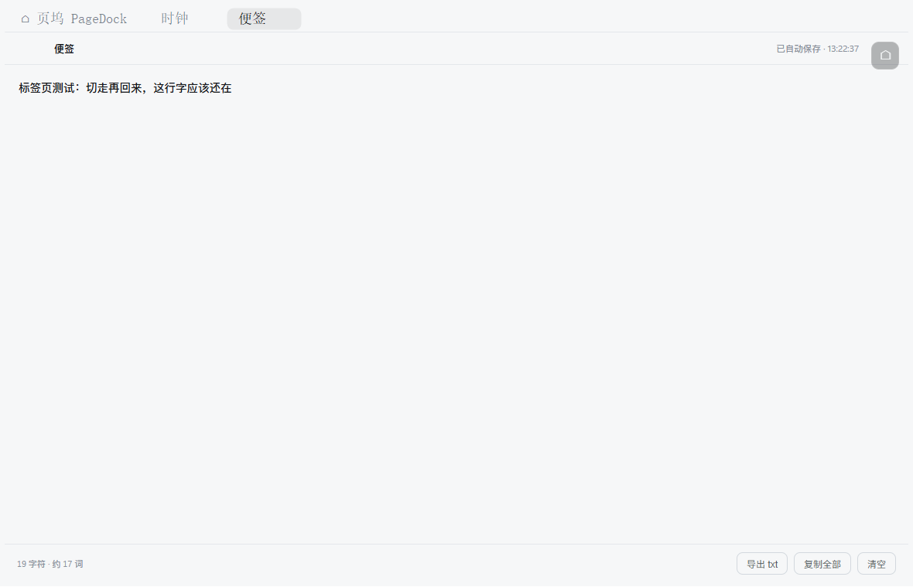

# 页坞 PageDock

> 轻量网页应用工作台 —— 把网址、HTML 单文件、离线小应用停进同一个码头。
> Windows 原生壳 + 系统 WebView2 运行时，主程序 71 KB，免安装、免运行库、单实例共享一个浏览器进程。

**当前版本：v0.9.27**




## 开源信息

- 项目主页：https://github.com/Maitool/PageDock
- 作者：Maitool（GitHub：https://github.com/Maitool）
- 许可证：MIT License，见 `LICENSE`；设置页面底部展示版权信息
- 贡献：见 `CONTRIBUTING.md`；安全漏洞报告：见 `SECURITY.md`

### v0.9.27
- 设置弹窗底部新增 GitHub 版权信息（点击跳转项目主页）
- 补充 `LICENSE`（MIT）、`.gitignore`、`CONTRIBUTING.md`、`SECURITY.md`，首次开源发布

## 名称释义

**页坞 · PageDock**：「页」即网页，「坞」即船坞——网页应用的停泊处，点一下即起航。
品牌仅出现在两处字符串（`ui/index.html` 与 `src/MainFrame.cs`），想改名改这两处即可。

## 与“用浏览器打开 HTML”的区别

| 场景 | 浏览器打开 | 页坞 |
|---|---|---|
| 找到并打开某个小工具 | 翻文件夹/书签，双击 | `Ctrl+Alt+D` 呼出 → 点卡片 / `Ctrl+K` 搜名字 |
| 界面观感 | 浏览器地址栏、书签栏、一堆标签混在一起 | 无边框纯应用窗口，像原生程序 |
| 同时开多个小工具 | 挤在浏览器标签堆里 | 工作台内多标签，互不干扰、**切换不丢状态** |
| 最小化后再想用 | 任务栏里翻 | 全局热键一键呼出，可缩到托盘 |
| 窗口尺寸 | 每次手动拉 | 独立窗口尺寸自动记忆 |
| 页面保存的数据 | 混进日常浏览器的站点数据 | 独立 data 目录，与浏览器隔离，删了即重置 |
| 占用 | 完整浏览器配置 + 扩展 | 共享系统 WebView2 运行时，无自带浏览器内核 |

一句话：**浏览器是“上网的地方”，页坞是“小工具的工作台”**——集中管理、秒级呼出、互不干扰。

## 快速开始

1. 双击 `bin\PageDock.exe`（或解压发布包后运行）。
2. 首次运行自动预置时钟、便签两个示例。
3. 「＋ 添加应用」或 `Ctrl+K` 命令面板：网址（自动补全/命名/favicon）/ HTML 文件 / 文件夹。

**系统要求**：Windows 10/11 + Edge WebView2 Runtime（系统通常自带）。

## 快捷键

| 快捷键 | 作用 |
|---|---|
| `Ctrl+Alt+D` | **全局呼出页坞**（任何界面生效，设置内可关闭） |
| `Ctrl+K` | 命令面板：搜应用/命令，`⏎` 打开、`⇧⏎` 独立窗口 |
| `Ctrl+Alt+→` / `←` | 在已打开的标签间循环切换 |
| `Esc` | 关闭面板/弹窗、清空搜索 |
| `F12` | 当前页面开发者工具 |

## 功能清单（v0.7）

### 一体化标签栏（v0.4 新）
- **窗口控制（最小化/最大化/关闭）、设置、＋添加应用、搜索框全部收进标签栏右侧**，不再占用页面空间
- 左上角 **logo 标签 = 工作台首页**：任何时候点它即回主页（应用内的悬浮返回按钮已移除）
- 标签 = 图标 + 名称，紧凑宽度；悬停显示 ✕ 关闭，关完自动回工作台
- 全套图标统一为同一套线性风格（原生 IconButton 与页面 SVG 同参数圆头线条）
- 搜索框实时过滤应用，`Ctrl+K` 随时聚焦搜索

### 主页卡片（v0.4 重设计）
- **单层图标磁贴**（68px 圆角方块，无外框卡片）：名称/来源不占版面，信息收进**悬停 2s 弹窗**（名称/类型/位置/标签，移开即消失）
- **操作收进右键菜单**（无边框浮层）：独立窗口打开 / 置顶 / 编辑 / 删除；磁贴悬停轻微上浮

### 应用分组（文件夹）（v0.7.9）
- **拖叠成组**：把一张卡拖到另一张卡上松手即成组（拖动中目标上浮出「成组」/「加入」提示）。组就是 `apps.json` 里一条 `kind:"group"` 条目，成员只多一个 `g` 字段 —— 搜索、编辑、标签、钉到桌面、持久化全部照旧，不需要另存一份成员列表
- **悬停即展开**：指针停在文件夹上 120ms（路过不弹）自动放大展开：文件夹本体 `scale(1.14)` 带上浮、成员逐个 pop 出场（`cubic-bezier(.34,1.56,.64,1)` 过冲），展开层按成员数排 1–3 列；**点展开层里的图标即打开应用**，再点文件夹 = 钉住展开 / 收起，Esc 与点外部收起，滚动时钉住的展开层跟随重定位
- **拖入 / 拖出**：任意卡片拖到文件夹上 = 加入（拖一个组拖到另一个组上 = 合并）；从展开层把成员拖回工作台空白处 = 移出（源文件夹亮一圈轻红边）；组内只剩 1 个成员时自动解散
- 右键文件夹：打开全部 / 重命名 / 置顶 / 取消分组 / 删除分组与应用；搜索或按标签筛选时分组自动打平，直接显示命中的成员

### 布局与遮罩的稳定性（v0.7.9）
- **拖窗口宽度不再抖动**：抖动来自纵向滚动条出现/消失让内容宽度来回差 10px —— `#main` 固定预留滚动条位（`scrollbar-gutter: stable`）；渲染改为按 id 复用节点 + FLIP，只在**列数真的变化**时补一次 0.26s 位移过渡，图标平滑滑进新位置而不是瞬移
- **弹窗遮罩下拖窗口不再闪白线**：无边框窗体那 6px 缩放边条的压暗必须画在 `OnPaintBackground`（即 `WM_ERASEBKGND`）而不是只画在 `OnPaint` —— 拖边框时新露出的边条会先被窗口底色刷一遍才轮到 `OnPaint`，那一帧就是遮罩外圈跳动的白线；`OnResize` 里再补一次 `Invalidate` 覆盖拉大窗口的情况
- 悬停上浮从 `.card` 下沉到 `.tile`：`.card` 的 transform 让给 FLIP 位移动画，两者不再互相覆盖

### 高分屏适配与图标一致性（v0.8.0 / v0.8.1）
- **顶部标签栏随系统缩放**：原生自绘界面用的是设备像素，而 WebView2 页面会跟随系统缩放——高分屏（如 250%）下页面磁贴放大到 170px，原生栏却还是 44px（约等于 18 逻辑像素），字几乎贴着边，看起来就是“菜单栏太矮”。现在栏高与栏内一切（标签高/图标/间距/搜索框/窗口按钮）都按 `DeviceDpi / 96` 换算，基础高度 44 → 48（v0.8.0）→ 56（v0.8.1，标签与窗口按钮上下更宽松）；换到另一块缩放比例不同的显示器时（`OnDpiChangedAfterParent`）自动重算并重绘
- **按钮图标同样缩放**：`IconButton` 的线性图标以 13px 视觉盒绘制，现在整组坐标按 DPI 缩放（笔宽一起放大），高分屏上齿轮/最小化/最大化/关闭不再缩在角落
- **内外图标就是同一张图**：左上角 logo 不再单独画一套图形，而是直接取程序自己的图标——`assets\app.ico`（多尺寸，内嵌）供 exe / 任务栏 / Alt-Tab，`assets\app.png`（512，内嵌）供界面内自绘，两者同源同图；图形本身沿用工作台原来那个 logo（青色描边圆角框 + 2×2 方块，上排中性灰、下排品牌青，透明底），由 `tools\make_icon.py` 按矢量参数绘制，改样式只需重跑脚本
- **图标更清晰**：窗口图标不再用 `Icon.ExtractAssociatedIcon`（只有 32px，高 DPI 下被系统放大发虚），改为从内嵌的多帧 ico 取用，系统按场景挑 32/48/64 帧；界面内 logo 从 512 的 PNG 缩到实际像素（含高 DPI 的 50~100px），并按尺寸缓存、DPI 变化时重建

### 文件夹（分组）展开（v0.8.1）
- **就地展开**：悬停展开的成员浮层对齐到文件夹卡片的正中心、盖住文件夹本身展开（原先是吊在卡片下方 10px 处），视觉上就是“文件夹被掀开”
- **会自己收回去**：浮层盖住卡片后，鼠标往往同时离开两者却不触发 `mouseleave`，导致弹开就收不回。现在用一次 `pointermove` 统一判定——指针不在「浮层 + 所属文件夹」这块区域内就排定收起（200ms 缓冲，从文件夹移向成员时不会半路收），回到区域内立即取消；窗口失焦、滚动、按 Esc、悬停切到别的分组也都会收起
- **去掉多余装饰**：文件夹顶部那条灰色“标签页”`ftab`、浮层上的灰色小三角 `caret` 全部删除（`padding` 随之改回对称）；展开时文件夹脸淡出，避免浮层比卡片小、上下各露出一圈灰色边线

### 文件夹外观与拖拽排序（v0.8.2）
- **文件夹不再带灰色描边，改轻微弥散阴影**：收起态文件夹脸与展开态浮层都去掉那圈 `border` 灰线，改用与图标风格统一的弥散投影（收起态浅、展开态更深一档，深浅主题各有一套阴影值）
- **展开/收起动效更线性、无断层**：过冲弹动曲线 `cubic-bezier(.34,1.56,.64,1)` 改为不回弹的 ease-out `cubic-bezier(.22,.61,.36,1)`、时长 `.14/.26s` 统一为 `.22/.24s`；成员不再用 `fpop` 逐个错峰弹出（那正是“有点快、有点断层”的来源），改成整层与文件夹脸交叉淡入淡出，中间不留空档
- **可拖拽调整顺序**：图标与文件夹都能拖动换位。为区分意图，按落点分区判定——
  - 压在另一张卡**正中**（水平 30%~70%）= 成组 / 加入分组（沿用原逻辑）；
  - 落在另一张卡的**左/右外侧**（两侧各约 30%）= 移动位置，出现一条**细而半透明、无发光**的竖线指示插入点（刻意做轻，不与成组的发光圈抢视线）；
  - 拖到**工作台空白处** = 移到末尾（用末尾一张卡的细插入线提示，不再画覆盖整网格的大虚线框）；把成员拖到浮层外 = 移出分组（源文件夹亮一圈轻红边），拖到别的卡上 = 加入其分组；
  - **移动文件夹本体**：悬停展开后浮层会盖住文件夹，此时在**浮层空白处按住拖动**即可移动该文件夹的位置；
  - 展开的浮层内，成员之间也能左右拖动重排（拖拽期间浮层不自动收起）。
- **顺序改为手动持久化**：`apps.json` 每条新增 `ord` 字段，网格与浮层都按 `ord` 排列，不再按“最近打开”自动上浮；`pinned` 仍表示“钉到桌面”但不再强制置顶。首次升级到本版时用旧的自动排序补齐 `ord`，现有观感不被打乱，之后完全尊重用户拖出的顺序

### 工具身份与数据分桶（v0.8.3）
- **每个工具有稳定身份**：以应用 `id`（而非 `file://` 路径）作为身份锚点。改名、搬家、升级 HTML 都不影响它的数据归属，从根上解决“路径即身份”带来的迁移/隔离难题
- **独立源隔离**：每个本地工具被映射到唯一虚拟主机 origin `https://app-<id>.local/`（WebView2 `SetVirtualHostNameToFolderMapping`），Chromium 的 localStorage / IndexedDB 天然按 origin 分区 —— 工具之间数据互不可见，与主程序、与浏览器都隔离
- **三桶目录**：`data\apps\<id>\html\`（HTML 源，单文件类自动纳管拷贝于此，文件夹类就地映射原目录）、`data\apps\<id>\output\`（工具导出的下载成果统一归位到此）、运行数据（在共享 WebView2 profile 内按 origin 分区）
- **HTML 热更新不丢数据**：编辑对话框新增「更新 HTML」，选新文件覆盖入口即可；因 `id`/origin 不变，工具已产生的 localStorage/IndexedDB 数据原样保留
- 一次性影响：升级到本版后，本地工具从 `file://` 切到 `https` origin，此前存于 `file` 源的旧 localStorage 对新 origin 不可见（相当于一次性重置）。内置示例无持久数据，不受影响

### 拖拽升级应用（v0.9.4）
- **把新版 HTML 直接拖到卡片上就是升级**：拖到已有卡片上时该卡片高亮（中性色双圈 + 右上角「升级」标签）并按升级处理；拖到空白处仍是「新增应用」（原有行为不变）。也可右键卡片 →「升级到新版本…」走系统选文件框
- **先比对，绝不静默覆盖**：弹窗并排列出当前与新版（应用名）的 页面标题 / 自报版本（`<meta name="app-version">`）/ 体积 / 行数 / 修改时间 / 指纹（SHA-256 前 5 字节），并给出「新增 N 行 · 删除 M 行，最早从第 K 行开始不同」；指纹相同直接告知“其实不必更新”，入口缺失（换机/误删）则告知“写回入口，身份不变”
- **确认后才写盘，数据一律保留**：应用 `id` 与 origin 不变，因此 localStorage / IndexedDB 与 `output\` 里的导出成果完全不动；旧版先存到入口同级的 `.history\`（滚动保留最近 5 份，同一秒连续升级也各留一份），再以无 BOM 的 UTF-8 覆盖入口；已打开的标签自动重载为新版
- 只接受本地页面（`kind` 为文件/文件夹）；网址类应用会提示“不是本地页面，无法用文件升级”

### 图标与取色（v0.9.5）
- **自定义图标不再有“外圈”**：以前带图标的磁贴会内缩 5px、垫一层面板底色并加圆角，等于凭空描了一圈边；圆形/六边形等形状还会被强行衬在圆角方块里，改形状就白改了。现在图标铺满整格、投影改由 `drop-shadow` 跟随图标实际轮廓（`.tile.img` 自身不再投影），**形状所见即所得**；图标文件读不出来时自动退回字母块，不留空格子
- **生成图标默认风格 = 内置字母块**：默认底色模式改为「淡色底」——主题色约 13% 透明度的淡底 + 同色文字，与首页未设图标时的字母块一模一样；字色默认跟随底色（用户手动改过字色后就不再跟随）。想要饱和渐变/纯色，手动切换即可
- **副色可点了**：副色色板不再被 `disabled` 掉，改为淡显提示「仅对角双色生效」；一旦选副色就自动切到「对角双色」模式，改动即时反映到预览
- **全站统一取色面板（带确定/取消）**：拦截所有 `input[type=color]` 的原生点击（新版 Chromium/WebView2 的原生取色浮层没有“确定”，即时生效、点外部就关），换成自绘面板——32 色色板 + HEX 输入 + 「更多颜色…」走系统取色 + 取消/确定（`Enter` 确认 / `Esc` 取消）。确认后回写颜色并派发 `input`+`change`，各处原有监听零改动。覆盖工作台（底色/副色/字色）与便签（字色/高亮/单元格底纹/边框颜色）全部选色入口；生成器面板与便签表格面板的“点击外部”判定都豁免取色面板，避免父面板被误卸载、事件丢失

### 全局呼出与窗口置顶（v0.9.6）
- **热键一键呼出真正生效**：以前从别的应用按 `Ctrl+Alt+D`，页坞常常“按了没反应”——因为进程不是前台时，`SetForegroundWindow` / `Activate()` 被系统“前台锁定”策略拦下，窗口拉不到最前；且缩到托盘再呼出时切换 `ShowInTaskbar` 会重建窗口句柄，绑在旧句柄上的全局热键被系统顺手注销，来回一次快捷键就彻底失灵。现在呼出走 `AttachThreadInput` 把本线程输入队列临时接到当前前台线程再强拉前台，并在句柄重建后自动重注册热键——**无论当前聚焦在哪个窗口，一键即唤出页坞**
- **窗口置顶图钉**：标题栏右侧新增图钉按钮（在齿轮左边），点一下把页坞主窗口钉在最前、再点取消；点亮时用强调色并在帽内加实心点，一眼区分开/关。置顶状态存进 `settings.topmost`，重启后保持
- **独立子窗口各自置顶**：每个“独立窗口打开”的应用标题栏同样带图钉，只影响自己那个窗口，与主窗口、与其他子窗口互不干扰；子窗口是临时窗口，置顶即时切换、关闭即忘，不跨重启记忆

### 标题栏图标重绘（v0.9.8）
- **置顶图钉改线描空心图钉**：参照实物图重绘为「圆角矩形钉帽（∏）+ 外扩钟形裙 + 平底座 + 直针朝下」的描边图钉（`GraphicsPath` 两段三次贝塞尔做裙摆外扩、圆头圆角连接），点亮仍整体变品牌青、未点亮为灰色描边，比此前的实心/斜置造型更耐看
- **设置图标改三条短横线**：由上一版的滑动调节条（三轨 + 旋钮）简化为三条等长短横线，去掉旋钮噪声、与小尺寸线性风格更统一

### 标题栏与便签细节修复（v0.9.9）
- **搜索框真圆角**：原生 `TextBox` 以前比手绘胶囊窄且矮，直角背景把右端圆角盖成方角；现在输入框与胶囊同宽同高，并用 `SetWindowRgn` 给控件本身套圆角区域
- **便签格式工具**：字体/字号下拉不再把“当前值”重复成第一项；标题循环按钮改下拉菜单；字号支持预设与自定义 px；清除格式显式恢复默认字号、字体与行距
- **符号与行距**：符号按钮及面板改用黑色 Ω 造型与黑色符号，并新增 1.0–1.3 的更小行距预设
- **图片裁剪与表格**：框选区域显示原缩放画面、裁剪后清除拉伸尺寸并按真实比例显示；合并单元格后光标留在合并格内
- **标签图标**：应用标签的字母图标缩到与左上角程序 logo 一致的视觉尺寸

### 搜索框与设置弹窗打磨（v0.9.10）
- **搜索框**：输入框内缩进胶囊直边区，光标不再被圆角裁掉、输入文字与胶囊垂直居中、左右圆角完全一致
- **设置不切页**：在应用标签上点设置时，首页 WebView 临时覆盖当前标签弹出设置，关闭后自动回到原标签，不再跳回工作台
- **便签**：字号支持单击选预设、双击直接输入自定义值；字体下拉不再重复出现“当前值”，收起框显示当前选择、展开由原生高亮提示；Ω 符号外加同粗细圆圈

### 便签字号与图片修复（v0.9.11）
- **字号控件改行距同款**：直接在框里输入数字回车生效，箭头弹出更全的预设（10–48 共 17 档），不再有“自定义”菜单项
- **图片选中框**：图片超出窗口时选择框按编辑区可视范围裁剪，手柄不再落到程序底栏
- **裁剪框**：修复 `drawImage` 参数错误导致的实心黑框——遮罩只压暗框外，框内 1:1 显示原图区域，呈虚线选框
- **Ω 图标**：重绘为方向正确的欧姆符号（顶部开口圆环 + 底部双脚），外圈同粗细圆圈保持不变

### 符号图标与选区遮罩（v0.9.12）
- **Ω 图标换用 Tabler**：弃用手绘符号，改用开源 Tabler Icons（MIT）的官方 omega 图标，与其他工具栏图标统一 `currentColor` 描边、1.8 线宽，颜色随主题一致
- **失焦选区遮罩**：选中文字后点工具栏（字体/字号等下拉）导致编辑器失焦、原生选区高亮消失时，按选区矩形用固定定位遮罩补画高亮；重新聚焦或执行操作后自动隐藏

### 选区颜色、清除格式与撤回（v0.9.13）
- **选区颜色统一**：编辑器显式定义选区蓝色（`--selbg`，亮/暗主题各调透明度），失焦遮罩复用同一变量——点工具栏时高亮不再从蓝色变成灰色
- **清除格式深度清理**：`removeFormat` 之外逐个剥离选区内元素的内联 background/color/font 系样式与 `<font>` 属性（保留对齐/行距等段落属性），网页粘贴带来的白色背景可被彻底清掉；光标落在带样式元素内时清除该元素
- **撤回/重做按钮**：工具栏新增 undo/redo（Lucide 风格箭头图标，走 `execCommand('undo'/'redo')`，与 Ctrl+Z/Ctrl+Y 同一撤销栈）

### 选区高亮引擎化与全局设置浮层（v0.9.14）
- **选区高亮换 Custom Highlight API**：弃用固定 div 遮罩，改用浏览器引擎级 `Highlight` + `::highlight(ed-sel)`（与 `::selection` 同一渲染路径，同一 `--selbg` 颜色）——点字体颜色/字号时色条高度与原生选区完全一致，不再闪现“另一个背景”；老内核自动回退遮罩矩形
- **撤回/重做移到最左**：工具栏首组即 undo/redo，与笔记库按钮之间加分隔
- **自绘工具提示**：悬停工具栏/小窗按钮时弹圆角主题化提示框（延迟 400ms，动态内容同样生效），替代系统原生 title 弹窗
- **设置覆盖任意页面**：设置按钮在任何标签上按下时，首页 WebView 以透明背景 + solo 模式（只渲染弹窗）浮在当前页面上方，当前页面直接透出成为模糊背景，不再“跳回程序坞”；关闭后由宿主复位
- **内置界面生成规范**：`spec\pagedock-web-ui.md`（含 reference/template）随程序打包，设置 → 开发 → “打开文件位置”直达

### 工具栏命令修复与小窗弹层化（v0.9.15）
- **修复 v0.9.14 回归**：Highlight API 可用时 `restoreRange` 里引用了已不存在的遮罩元素导致 TypeError，字体/字号/颜色/清除格式全部静默失效、焦点回不到编辑器（字体下拉出现“重新选中”假象）；已改为按可用路径分别清理高亮
- **撤回/重做位置**：调整到笔记库按钮右侧（第 2、3 位）
- **小窗弹层化（手机小窗式）**：便签笔记库、时钟设置在钉到桌面的小窗里不再整窗覆盖——改为底部弹层（约七成高、圆角顶边、暗背板），正文/表盘保留在背后仅变暗；点弹层外、头部 ✕、Esc 均可关闭（便签库新增 ✕）

### 选区高亮单一绘制者（v0.9.16）
- **根因根治“点击工具栏就跳动”**：此前聚焦时由原生 `::selection` 画、失焦时由 Highlight API/遮罩画，点击字号/字体等控件必然切换焦点，两种画法的色带高度位置不同 → 视觉跳动。现原生选区设为透明，聚焦/失焦一律由同一自绘遮罩绘制，任何操作前后渲染完全一致
- **混排行内等高统一**：中英文/字号/行距混排时 `getClientRects` 按字形碎片返回多条、高度参差——现按“行”合并碎片（垂直重叠超小者 45% 视为同一行），每行以最高碎片高度统一，再按该行行盒补齐，一行只出一条等高色带

### 字体下拉与待办（v0.9.17）
- **字体下拉去掉占位项**：占位 option 加 `hidden`——不再出现在下拉列表里，未匹配字体时收起框仍可显示当前值（实测 Chromium 行为）
- **字体扩充到 14 款**：新增 仿宋、隶书、幼圆、等线、华文行楷、Georgia、Times New Roman、Courier New（FONT_MAP 同步回显名）
- **待办勾选框**：工具栏新增待办按钮——当前块一键转为方框条目（再点移除），光标不在块内时插入新待办；方框 `contenteditable=false`，点击在 方/勾 间切换，状态随内容自动保存

### 待办体验修正（v0.9.18）
- **光标位置**：插入/转换待办后光标固定落在方框之后同行（此前会掉到下一行）
- **垂直居中与字号自适应**：方框尺寸/边框/圆角全部改 `em` 单位，随所在文字字号缩放（大字号待办方框同步变大），`vertical-align:middle` 与同行文字居中
- **完成态**：勾选后整块文字划线 + 置灰（方框为原子内联盒不受划线影响），取消勾选即恢复；在待办条目末尾回车换行时新行不继承完成态

### 待办光标与对齐终修（v0.9.19）
- **光标不再与方框重叠**：空待办块补 `<br>` 撑起行盒（编辑器空行标准模式），光标稳定落在方框右侧同一行，不再掉到方框下方
- **方框与文字对齐**：四组 `vertical-align` 取值截图对比后选定 `baseline`——中文环境下方框与文字视觉居中最佳（此前 middle 偏低、文字显得偏高）

### 待办结构重排（v0.9.20）
- **方框脱离行盒**：方框改绝对定位、待办块加 `padding-left`，文字走正常文本流——光标高度与普通文字一致，输入文字必然与方框同行且垂直居中（此前行内方案在中文/混排下反复出现光标下沉、文字偏高）
- **旧数据自动迁移**：加载历史便签时给含方框的块自动补布局类，空块补 `<br>`，老笔记打开即用新排版

### 全屏与便签打磨（v0.9.21）

### 标签省内存（v0.9.22）
- **后台标签自动挂起**：切走标签即 TrySuspend（浏览器进程级挂起，CPU/GPU 停摆、内存回落），切回自动恢复
- **空闲标签释放**：连续 10 分钟未激活的标签彻底释放 WebView 只留元数据，下次激活惰性重建（localStorage/IndexedDB 在磁盘，数据不丢）
- **首页常驻**：工作台/设置标签永不挂起，避免搜索与设置弹窗要唤醒的开销

### 下载按钮与代码保护（v0.9.23）

### 细节修正（v0.9.24）

### 遮罩边缘闪烁修正（v0.9.25）

### 边条压暗彻底移除（v0.9.26）
- **遮罩边缘两段式闪烁**：首开设置时仍会先看到边条压暗、遮罩后到（原生绘制与 WebView 渲染节奏不同）。彻底去掉原生边条压暗，改为弹窗打开时让 WebView 临时铺满左/右/下缩放边条，遮罩连同边缘一起盖住，关闭即恢复常规布局
- **设置遮罩边缘灰线**：遮罩此前有 150ms 淡入，而窗口四周 6px 缩放边条的原生压暗是瞬时完成——先看到一圈灰线、遮罩后到。改为遮罩瞬时出现与边条同步（弹窗本体的弹出动画保留）
- **数据目录打开方式**：路径是目录时直接打开该目录，不再误入 spec 文档回退逻辑
- **Esc 退出全屏**：全屏状态下按 Esc 即还原（悬浮按钮保留）
- **顶栏下载按钮**：置顶按钮右侧新增（下载图标）——本地工具打开其“导出成果”目录（`data\apps\工具id\output`），网页类工具打开系统下载目录
- **代码保护**：发布版关闭 DevTools、拦截 `view-source:` 导航（右键菜单此前已禁用），防止直接查看工具源码
- **删除确认框层级**：便签删除确认弹窗提到所有遮罩之上（z-index 300），不再被笔记库遮罩压住
- **设置瘦身**：删去“数据”下方目录说明行；“界面生成规范-打开文件位置”修复路径归一 + 回退逻辑，不再落到桌面
- **主程序/独立程序窗口全屏**：顶栏新增全屏按钮（⛶）——点击隐藏顶部栏、窗口铺满整屏；鼠标上移到屏幕顶部边缘浮现圆角“退出全屏”悬浮按钮，点击即还原
- **便签新增按钮**：撤回左侧新增“＋新建便签”，无需打开笔记库侧边栏
- **待办方框微调**：方框位置上移约 1px，与同行文字视觉居中（修正偏下）

### 标题栏图标与对齐打磨（v0.9.7）
- **置顶图钉改斜置（45°）**：主窗口与独立子窗口的图钉统一换成 Windows 11 式斜置图钉（旋转 45°：帽顶 + 帽体两斜边 + 底盘 + 针），点亮仍用强调色 + 帽内实心点，语义更直观
- **设置齿轮改滑动调节条**：齿轮（8 齿 + 中心圆）换成三条水平滑轨 + 各自旋钮的调节条图标，与右侧窗口图标同一线性风格、更清爽
- **按钮悬停高亮改圆角胶囊并与搜索框同高**：右上角按钮此前悬停是铺满整格的直角矩形，现改为圆角胶囊，高度与圆角和左侧搜索框完全一致（`IconButton.PillHeight/PillRadius` 由标签栏统一传入），关闭钮的红色高亮同样收进圆角
- **搜索框占位文字垂直居中**：此前占位文字（Label 顶部对齐 + 从框顶下移 2px）整体偏高，与右侧图标不在一条中线；现改为在统一胶囊内垂直居中，搜索框、占位文字、五个图标四者同圆心

### 备份与迁移（v0.8.3）
- 设置中心「备份与迁移」：**导出整包 / 导出轻量 / 导入**，一键打包成 `.zip`，换机后导入即完整复原
- **整包**：`apps.json` + `data\apps\**`（源与导出成果） + WebView2 profile（各工具的 localStorage/IndexedDB），换机零迁移成本、连工具数据一起带走；个别正被占用的缓存文件尽力跳过
- **轻量**：仅 `apps.json` + `data\apps\**`（清单与源、导出成果，不含运行数据），体积小、适合只迁移应用本体
- 导入时清单与 `apps\**` 立即覆盖生效；若为整包（含内核数据），先暂存、下次启动时替换 WebView2 profile 完成完整还原（会提示重启）

### 全局快捷启动（v0.8.3）
- **开机自启常驻**：设置中心开关写入 `HKCU\...\Run`（开启自启时若关闭方式为“退出”会自动切为“缩到托盘”，保证常驻可呼出）
- **单实例唤起**：再次双击 exe 不再报“已在运行”，而是唤起已有主窗口（`instance.json` 记录句柄 + 跨进程 `PostMessage` 唤起）；冷启动 → 开机自启常驻 → 热键一键呼出
- **可自定义全局热键**：设置中心把原开关升级为「录入组合键」，捕获 Ctrl/Alt/Shift/Win + 键（默认 `Ctrl+Alt+D`），注册失败自动回退默认并写 `data\hotkey.log`

### 多标签工作台
- 工作台内打开 = 开一个**独立标签**，每个标签持有独立渲染上下文：**切换标签、回到工作台都不会中断页面运行**（计时器、输入中的内容、播放全部保活）
- 同一应用始终复用同一标签；点卡片即可回到已打开的页面

### 主题（v0.3 增强）
- 深浅色 + 跟随系统，**默认跟随系统**，切换入口在设置中心；**页面色彩偏好同步**（`prefers-color-scheme`）：内置示例与遵循该标准的页面会随主题变色
- **全局黑白灰基调**：强调色全部中性化（选中态/开关/按钮），仅 logo 保留品牌色
- 说明：任意外部页面的配色由页面自己决定——遵循标准的会跟随，写死颜色的保持原样（与浏览器行为一致）
- 实现要点（v0.7.5）：`PreferredColorScheme` 是共享 profile 级且会被记住，**「跟随系统」必须写回 `Auto`**；启动时先读设置定色调，避免先深色再跳浅色。钉到桌面的小部件不再单独指定色彩偏好，主题与主窗口/系统保持一致
- 实现要点（v0.7.7）：“跟随系统”不难判断（读注册表 `AppsUseLightTheme` 即可），难的是**首帧拿不到准信**：WebView2 的色彩偏好是 profile 级、异步生效且会被上次运行记住，页面首帧问 `prefers-color-scheme` 可能拿到旧值。因此现在由宿主在建窗之前算好结论——原生窗体底色一次到位，页面用 `AddScriptToExecuteOnDocumentCreated` 在文档创建时就把 `data-theme` 与 `window.__pdTheme` 注入，页面脚本首帧直接复用，不再自己问

### 其他
- 置顶 ▲、标签分类筛选、搜索、最近使用排序
- favicon 三级回退（站点 → Google → 字母块）+ 自定义图标
- 独立窗口：无边框深/浅色标题栏（按钮顺序与主窗口一致、整条可拖动）、**一键“移入工作台”切回主窗口标签**、尺寸记忆、`target=_blank` 自动走独立窗口
- **拖拽 HTML 入坞**：拖 HTML 文件进主窗口 → 弹窗显示文件名/大小（名称可改）→ 确认后保存副本到数据目录、加入应用列表并自动打开；若直接拖到**已有卡片**上则转为升级（见「拖拽升级应用」）
- **路径可移植**（v0.7.8）：内置示例在配置里存相对路径 `samples\时钟.html`；使用时还会回退解析（绝对路径失效 → 按文件名回 exe\samples），整个目录连 `data` 拷到别的电脑/换目录都能打开
- **钉到桌面（桌面小部件）**：右键任意应用 → 钉到桌面；小组件平时只显示主信息（时钟 = 时间 + 日期，便签 = 编辑区），工具与设置全部“按需出现”；钉住状态与位置尺寸会持久化，重启自动还原；重复钉 = 聚焦
- 小部件实现：无边框置底窗口（`ShowInTaskbar=false` + 定时压到 Z 序最底），主题随设置/系统，不再强制浅色；注意它仍是普通窗口，按 Win+D「显示桌面」时会跟着最小化（挂真桌面层 Progman 的方案在 v0.7.4 已移除）
- 托盘常驻（关闭→缩到托盘）、全局呼出热键 Ctrl+Alt+D（可在设置关闭）
- 内置示例：时钟（字重 400·时钟与日期水平居中·日期字号更接近时钟·按住左键从屏幕左/右缘向中间拖动 ≥30px 呼出设置，碰边不弹、呼出后松开不消失（手势收尾 click 吞掉，慢拖也稳定），点面板外自动收起；底部提示文字移除，改为首次使用时一次性浮现提示·制式/秒/日期样式/字号/主题/防烧屏/全屏）、便签（多便签笔记库·点外部自动收起·图形化工具栏图标·字号/字体/行距实时显示当前值，行距可输入任意值·插入常用符号 64 枚·富文本排版：加粗/斜体/标题/列表/引用/颜色/高亮/字号/字体/缩进（Word 式 ±40px，列表内嵌套）/对齐·表格可选行列新建+拖选相邻单元格（矩形高亮）+合并（拼接自动去空行，不再撑高行）/增删行列/拆分/单元格背景·图片粘贴拖入+拖角缩放+双击裁剪·字体颜色/高亮改图标+色条按钮（色条实时跟随所选颜色，一目了然）·行距输入框隐藏步进箭头、附下拉预设（点箭头选 1.4–3.0，也可直接输入）·导出 txt/md/html/doc·保存提示底部居中胶囊·清空/删除确认弹窗与整体 UI 同风格）

#### 小部件交互准则（v0.7.6 重做）

调研 Apple HIG 与 Windows 11 小组件的通行做法：**小部件只负责“看一眼 + 最小干预”，完整编辑留在主程序**。
两个内置示例据此重写了小组件形态：

| 准则 | 落地 |
|---|---|
| 只显示主要信息 | 时钟：时间 + 日期；便签：编辑区。工具栏、底栏、字数统计、悬浮按钮默认全部不可见 |
| 控件按需出现 | 鼠标进窗才在左下角淡入半透明入口（不抢视线），指到按钮或键盘聚焦才全亮；便签编辑时浮出 B/I/列表/更多，失焦 1.2 秒自动收起；面板打开时入口自己让位 |
| 操作 ≤ 3 步 | 时钟：进窗 → 点齿轮 → 改；便签：点正文 → 点 ⋯ → 操作；面板带 ✕ 一步收起，Esc 同样有效 |
| 状态持久化 | 设置存 `localStorage`；钉住状态与位置尺寸写 `apps.json`（`wp` + `wx/wy/ww/wh`），重启自动还原；**退出程序时的小组件关闭不算“取消钉住”**（宿主 `Program.Exiting` 屏蔽） |
| 无障碍 | 入口 `role=button` + `aria-label` + `aria-expanded`，面板 `role=dialog` / `role=toolbar`，Esc 收起，打开后焦点进面板；`@media (forced-colors: active)` 补边框适配高对比度 |
| 资源占用 | 复用全进程共享的 `CoreWebView2Environment` 与 profile，不额外起浏览器进程 |

窄窗（253×187 CSS 像素）下的具体调整：时钟设置面板改自底部滑入的**整窗覆盖**（原 264px 侧栏会被裁成一条），行距收紧、字号 12.5px、隐藏“全屏显示”；便签隐藏 `#bar`/`footer`，`footer`（导出/复制/清空 + 字数）移进工具浮层，浮层整窗宽、分组换行、只留高频格式（字号/字体/行距/缩进/对齐/表格/符号/取色回主窗口），笔记库侧栏同改整窗覆盖



## 架构

```
PageDock.exe (77KB, C#/WinForms, .NET Framework 4.8 系统自带)
 ├─ ui/index.html + app.css + app.js     工作台界面（双主题设计令牌见下）
 ├─ src/TabStrip.cs                      自绘导航/标签栏（logo+标签+搜索/控制簇，每标签独立 WebView2）
 ├─ src/TitleBar.cs + IconButton.cs      独立窗口标题栏与统一线性图标按钮
 ├─ Microsoft.Web.WebView2.*.dll         WebView2 托管互操作
 ├─ WebView2Loader.dll                   WebView2 原生加载器
 └─ msedgewebview2.exe（系统共享运行时）  共享浏览器进程，多标签/多窗口省内存
```

- 标签页与独立子窗口共享一个 `CoreWebView2Environment`；`RegisterHotKey` 实现全局呼出；
  主题经 `set-theme` 同步原生 UI，并写入 `Profile.PreferredColorScheme` 让页面跟随（auto 写 `Auto`，
  否则上一次的固定深浅会被 profile 记住，页面 `prefers-color-scheme` 恒为单值，跟随系统失效）。
- 钉到桌面的小部件用字符串 `Navigate()` 打开 `...?widget=1`：`.NET Uri` 会把 `file://` 里的 `?`
  转义成 `%3F`，导致本文件被当成不存在的文件名（Edge 报 `ERR_FILE_NOT_FOUND`）。

### 设计令牌（ui/app.css）

| 令牌 | 深色 | 浅色 |
|---|---|---|
| --bg / --panel / --card | #0B0C0E / #101216 / #131519 | #F6F7F8 / #FFFFFF / #FFFFFF |
| --text / --text-2 / --text-3 | #E7EAEE / #9AA1AB / #6B7280 | #17191C / #565D66 / #7A828C |
| --accent（对比度 ≥ 4.5:1） | #2DD4BF（墨 #062823） | #0B8074（墨 #FFFFFF） |

字体 Segoe UI Variable / Microsoft YaHei UI；圆角卡 12px、控件 9px；间距 4 基数。

## 构建与开发

```powershell
powershell -NoProfile -ExecutionPolicy Bypass -File build.ps1
```

系统自带 `csc.exe` 编译，无需 SDK；依赖 `lib\` 下 WebView2 互操作 DLL（已就位）。
目录：`src\` 宿主 · `ui\` 界面 · `samples\` 示例 · `tools\` 辅助脚本 · `assets\` 图标清单。

## 常见问题

- **SmartScreen**：exe 未签名，「更多信息 → 仍要运行」。
- **热键无反应**：Ctrl+Alt+D 可能被其他软件占用，`data\hotkey.log` 可查注册结果与触发记录。
- **favicon 抓不到**：自动回退，也可在编辑里指定本地图片。
- **数据在哪**：`data\apps.json`（清单）+ `data\apps\<id>\`（各工具源与导出成果）+ `data\webview\`（内核与按 origin 隔离的运行数据），删除即重置；换机用设置中心「备份与迁移」整包导出→导入

## 路线图

- **v0.8.3 已完成**：配置/数据整包导出导入 · 每工具按 origin 的数据隔离 · 开机自启常驻 · HTML 热更新不丢数据 · 自定义全局热键
- **v0.8.5 已完成**：便签符号扩充 · 最大化边缘手势修复 · 内置程序化图标生成 · 便签侧栏标题优先 · 便签表格行高/列宽/边框可调
- **v0.8.6 已完成**：便签符号图标更换 · 图片 Word 式拖拽缩放 · 裁剪可选比例框 · 表格边框仅作用框选单元格且线型可视化
- **v0.8.7 已完成**：便签表格选中改整块外框（消除相邻格粗双线）· 表格设置面板对齐 Word（对齐九宫格/单元格边距/套用边框/自动调整/拆分表格/删除表格）· 符号图标改 ±、表格图标改带表头网格
- **v0.8.8 已完成**：表格选中改单元格底色（消除外框溢出/错位）· 修复合并误报未选中 · 新增表格工具条（高频操作上栏）· 右键设置面板同类同行重排
- **v0.8.9 已完成**：便签表格补齐 Word 三项设置——文字方向（横向/竖向，作用框选格）· 标题行重复（首行入 `thead`，长表/打印表头逐页跟随）· 表格排序（按光标所在列升/降序，自动跳过表头）
- **v0.9.0 已完成**：便签表格工具条图标化重构——工具条改单行统一风格线性图标（16px Lucide 式自绘集，离线无外部依赖）· 线型/行高列宽/边距/边框/底纹/自动调整/文字方向/标题行/排序全部收进工具条并改为 Word 式下拉面板 · 滚轮在工具条上左右滑动 · 右键菜单只留合并/拆分/拆分表格等低频结构项与剪贴板（与工具条零重复）· 右键面板滚动条改圆角且左右对称 · 符号面板改 8 列网格消除右侧大片空白
- **v0.9.1 已完成**：工具栏真正单行——表格按钮不再另起一行，直接接在主工具栏同一行末尾（分隔线 + 「表格」小标签，光标进表格才出现）· 溢出时行尾浮出右箭头提示右侧还有工具，点一下平滑右移、滑到最右自动消失 · 滚轮在整条工具栏任意位置都能左右滑动（无溢出时不抢页面滚动）
- **v0.9.2 已完成**：生成图标面板不再被窗口裁掉（不够高时自动往上翻）· 本地网页的默认名称统一取网页内容自己的标题（与标签页一致，不再一个用文件名、一个用网页名）
- **v0.9.3 已完成**：设置/搜索在任何标签下都能弹出（先自动切回首页再投递事件）· 图标生成器扩充（5 形状 / 4 底色 / 4 纹理 / 1–4 字自动排版）
- **v0.9.4 已完成**：拖拽升级本地应用——把新版 HTML 直接拖到卡片上（或右键「升级到新版本…」选文件），先出比对表（标题/自报版本/体积/行数/修改时间/指纹 + 增删行数与首个差异行），确认后才覆盖入口；应用 id 与 origin 不变，localStorage/IndexedDB、导出成果一律不动，旧版自动存进 `.history`（滚动留最近 5 份）
- **v0.9.5 已完成**：图标与取色打磨——自定义图标去“外圈”衬底、形状所见即所得（圆形/六边形不再被衬在圆角方块里）· 生成图标默认风格与内置字母块一致（淡色底 + 同色字，字色随底色自动跟随）· 副色不再禁用（选副色自动切对角双色）· 全站统一取色面板（32 色板 + HEX + 系统取色 + 确定/取消），拦截原生 `input[type=color]`，覆盖工作台与便签全部选色入口
- **v0.9.6 已完成**：全局热键唤起修复——用 `AttachThreadInput` 绕过“前台锁定”强拉前台，句柄重建后自动重注册热键，解决“从别的应用按 `Ctrl+Alt+D` 没反应”和“缩托盘再呼出后快捷键失灵”· 窗口置顶——主窗口标题栏图钉（走 `settings.topmost` 持久化、重启保持），独立子窗口标题栏各带图钉（仅影响自己、即时切换不记忆），点亮用强调色 + 帽内实心点
- **v0.9.7 已完成**：标题栏图标与对齐打磨——置顶图钉改斜置 45°（类 Win11）、设置齿轮改滑动调节条；右上角按钮悬停高亮由直角满格改圆角胶囊、与搜索框同高同圆角（关闭红底一并收圆角）；搜索框占位文字垂直居中、与图标同中线。另将主程序与内置网页程序的界面语言提炼为项目级开发 skill `.qoder\skills\pagedock-web-ui`（双主题令牌 / 组件配方 / 主题握手 / 起步骨架）
- **v0.9.8 已完成**：标题栏图标重绘——置顶图钉改为线描空心图钉（圆角矩形钉帽 + 外扩钟形裙 + 平底座 + 直针，参照实物造型，点亮变品牌青）；设置图标由滑动调节条简化为三条等长短横线
- **v0.9.9 已完成**：搜索框真圆角 · 字体/字号重复项与字号生效/自定义/清除格式修复 · 标题下拉 · 黑色 Ω 符号与更小行距 · 裁剪预览与比例修复 · 合并单元格光标回位 · 标签字母图标尺寸对齐 logo
- **v0.9.10 已完成**：搜索框光标/居中/圆角一致性修复 · 设置弹窗覆盖当前标签（关闭回原标签）· 字号双击自定义 · 字体下拉去重并原生高亮 · Ω 加圆圈
- **v0.9.11 已完成**：字号改行距同款输入框+17 档预设 · 图片选择框按编辑区裁剪 · 裁剪框虚线化并修复实心黑框 · Ω 欧姆符号方向修正
- **v0.9.12 已完成**：Ω 图标改用 Tabler 官方开源图标（统一描边颜色）· 编辑器失焦时选区遮罩保持高亮
- **v0.9.13 已完成**：选区蓝色统一（原生与失焦遮罩同色）· 清除格式深度剥离粘贴的内联背景/颜色 · 工具栏新增撤回/重做
- **v0.9.14 已完成**：选区高亮改 Custom Highlight API（与原生选区同渲染路径）· 撤回/重做移至最左 · 自绘圆角工具提示 · 设置弹窗透明覆盖当前页面（不跳程序坞）· 内置界面生成规范并在设置中可打开位置
- **v0.9.15 已完成**：修复 restoreRange 空引用导致的字体/字号/颜色命令失效 · 撤回/重做移到笔记库右侧 · 小窗内便签库/时钟设置改底部弹层（背板 + ✕ + Esc 关闭）
- **v0.9.16 已完成**：选区高亮改为单一绘制者（原生选区透明 + 自绘遮罩常驻）· 碎片矩形按行合并并以最高字高统一（混排一行一条等高色带）· 点击工具栏控件不再跳动
- **v0.9.17 已完成**：字体下拉占位项隐藏 · 字体扩到 14 款（仿宋/隶书/幼圆/等线/华文行楷/Georgia 等）· 新增待办勾选框（当前块转换 + 点击勾选 + 随笔记保存）
- **v0.9.18 已完成**：待办光标落在方框后同行 · 方框 em 化随字号缩放并与文字垂直居中 · 勾选完成态（划线置灰，回车换行不继承）
- **v0.9.19 已完成**：空待办补 `<br>` 撑行、光标不再与方框重叠 · 方框对齐改 baseline（截图对比选定，中文最居中）
- **v0.9.20 已完成**：待办方框改绝对定位 + 块缩进结构（光标/文字与方框同行垂直居中）· 旧便签数据自动迁移
- **v0.9.21 已完成**：主程序与独立窗口全屏（隐藏顶栏 + 顶部边缘悬浮退出按钮）· 便签撤回左侧新增建按钮 · 待办方框与文字居中微调
- **后续**：本地文件逐项授权（收紧 `--allow-file-access-from-files`）· 发现页 · 在线检查更新 · 强调色自定义 · 标签持久化（重启恢复）

## 已验证（2026-10-24）

- 多标签：开时钟+便签两标签 → 便签输入文字 → 切走再切回**文字原样保留**（截图 v3-back）✓
- `Ctrl+Alt+→` 循环切换 ✓；标签 ✕ 关闭自动回工作台 ✓
- 全局热键：注册成功、WM_HOTKEY 触发、最小化→呼出恢复 ✓
- 主题跟随：浅色模式下时钟/便签页面自动变浅色 ✓
- 便签：字数统计（19 字符 · 约 17 词）、导出 txt、自动保存 ✓

## 已验证（2026-10-24 · v0.4 UI 改版）

- 标签栏一体化：搜索框/添加/设置/─▢✕ 入栏，主题切换后原生控件同步变色 ✓
- logo 标签回主页 ✓；应用内无返回按钮 ✓；标签 = 图标+名称 ✓
- 主页紧凑卡片 + 悬停 2s 信息弹窗 + SVG 操作条 ✓；设置开关与文字同行 ✓
- 独立窗口标题栏 ─▢✕ 与主窗口一致、可拖动 ✓
- v0.4.2：全 Neutral 色板（无强调绿）✓；右键菜单/悬停弹窗去线框 ✓；弹窗滚动条收进圆角 ✓；便签多便签侧边栏（新建/搜索/删除/自动标题）✓
- v0.4.3：标签字母图标超采样+墨迹居中（偏移/裁切根除）、logo 4x 超采样 ✓；全程序字体统一微软雅黑 UI（含数字）✓；搜索框文字对齐、随 44px 标签栏居中 ✓；时钟主页净化+左缘滑出设置面板 ✓；便签图标呼出+全量排版工具+图片拖角缩放/双击裁剪 ✓
- v0.4.4：时钟设置分段按钮全部可用 ✓；呼出改左右缘向内滑动手势（无提示样式）✓；防烧屏默认开启 ✓；主题默认跟随系统 ✓；便签占位文案+光标自动落点（空选点工具栏也生效）✓；导出 txt/md/html/doc ✓；钉到桌面小组件 ✓
- v0.7.0：便签侧栏滑出层加 visibility 收敛（左侧半透明渐变灰与边缘竖线根除）✓；缩进改纯缩进 div（Chromium 自动 blockquote 转换，灰色背景根除）✓；字色/高亮/字号/字体选区保存-恢复（点击后可靠应用）✓；工具栏全面图形图标（13 枚线性 SVG）✓；行距下拉自由选择（全局记忆）✓；表格可选行列插入+右键增删行列/合并/拆分/单元格背景，格内可继续排版 ✓；编辑区右键菜单（剪贴板/图片/表格）✓；时钟+日期水平居中、日期字号提升 ✓；呼出改按住左键拖拽手势（碰边不弹）✓；程序内右键菜单背景统一 --bg（浅色下不再白色突兀）✓
- v0.7.1：钉到桌面改真桌面层（Progman 子窗口 WS_CHILD，修复假钉与临时 WorkerW 消失）✓；小组件位置确定性（构造期 Shown 定位，修复位置随机）✓；顶部工具条拖动+右下角缩放角（修复不可移动/不可缩放）✓；小组件默认浅色（PreferredColorScheme=Light）✓；widget 模式（时钟/便签）：常驻工具栏隐藏、悬浮按钮主动呼出浮层 ✓；NRE 根因定位修复（RepositionBarButtons 基类构造期 OnResize null guard）+ FirstChance 日志工具 ✓；便签侧边栏点外部自动收起（小组件/普通模式均验证）✓
- v0.7.2：表格拖选相邻单元格（矩形范围高亮 cell-sel，合并优先用框选范围）✓；字号/字体/行距显示当前值（selectionchange 回显）✓；行距可输入任意值（number+datalist 预设，全局记忆）✓；插入常用符号 64 枚（Ω 面板，光标处插入）✓；缩进完全自实现（selectedTopBlocks Word 式 ±40px，修复减少缩进无反应与 Chromium 缩进翻倍；列表内原生嵌套；支持跨段/表格内）✓；保存提示移底部居中胶囊（1.6s 淡出）✓；原生 confirm 全部换统一风格确认框 ✓；时钟侧栏 visibility 收敛（左缘白线与灰渐变根除）✓；时钟呼出后松开鼠标不再消失（450ms 外点抑制）✓；拖拽 HTML 文件先弹窗确认再加入并打开（save-drop 副本到 data\dropped）✓
- v0.7.3：时钟侧栏底部提示文字移除、首次使用浮现一次性提示 ✓；手势收尾 click 吞掉（慢拖 >450ms 呼出后松开不再消失，armed 标记替代纯时间窗）✓；合并单元格拼接去空行（合并后行高不再增加）✓；字体颜色/高亮按钮图标化（A/荧光笔 SVG+底部色条实时同步所选颜色，input color 透明覆盖点击）✓；行距 number 输入隐藏 spinner+右侧 ▯ 下拉预设菜单（含 toggle 判定）✓；设置弹窗"打开目录"按钮防挤压竖排（nowrap+flex:none）✓
- v0.7.5：钉到桌面小组件加载本地页面改用字符串 `Navigate()`（修复小部件 ERR_FILE_NOT_FOUND）✓；主题「跟随系统」写回 `Auto`（profile 级的 `PreferredColorScheme` 会被记住，避免切过固定深浅后跟随失效）✓；小部件不再单独指定色彩偏好，与主窗口/系统一致、不再强制浅色 ✓
- v0.7.6：桌面小部件重做——平时只显示主信息、工具与设置按需出现。时钟：默认只有时间+日期，齿轮仅在鼠标进窗时于左下角淡入，设置面板改自底部滑入的整窗覆盖（12.5px 行距收紧、隐藏全屏、面板打开时隐藏齿轮、小组件不再弹边缘手势提示）；便签：默认只有编辑区，进入编辑才在右上角浮出紧凑极简条（笔记库/B/I/列表/⋯），⋯ 打开整窗工具浮层（只留高频格式 + 字数 + 导出/复制/清空 + ✕ 收起，窄窗无横向溢出、字数不再竖排），笔记库侧栏整窗覆盖，面板打开时入口与极简条自动让位；原生顶部工具条/缩放角改为光标靠近顶部/右下角才出现；入口与面板补 role/aria-label/aria-expanded/aria-hidden、Esc 收起、焦点进面板与回到入口、forced-colors 高对比度边框；钉住状态与位置尺寸持久化（apps.json 新增 `wp` + `wx/wy/ww/wh`，启动 `restoreWidgets()` 还原；退出程序时的小组件关闭由 `Program.Exiting` 屏蔽，不再误判为取消钉住）✓
- v0.7.7：修复启动时“先黑一下再跳浅色”的闪烁。根因不是判断难，而是判断得太晚：`Theme.Dark` 初值硬编码 `true`，窗体基类构造函数里就用它算好 `BackColor`（深色 #0B0C0E），而 `MainFrame` 读到设置后虽把 `Theme.Dark` 改成浅色却没有回刷底色，直到页面发来 `set-theme` 才变浅。现在启动流程改为「先定主题、再建窗」：`Program.Main` 在 `new MainFrame()` 之前调用 `Theme.ResolveFromConfig()`（apps.json 的 `settings.theme` + 注册表系统主题），`Theme.Dark` 初值也改为直接取系统主题兜底；同时页面首帧改用宿主注入的结论（`data-theme` + `window.__pdTheme`，以 `AddScriptToExecuteOnDocumentCreated` 早于页面脚本执行），不再在首帧问可能过期的 `prefers-color-scheme`。实测启动首帧即浅色，全程无深色帧 ✓
- v0.7.8：默认窗口放大（1180×760 → 1440×900，且不超过工作区减 60px，1366×768 笔记本也放得下）✓；弹窗遮罩外圈那圈白线根除——它不是遮罩的边框，而是窗体四周为保留边缘拖拽而留的 6px 缩放边条（窗口底色），遮罩压暗页面后它就显得发白；现在页面开/关弹窗时发 `set-dim`，宿主把页面左/右/下三侧边条刷成遮罩等效色（`Theme.GutterDim`，与 app.css 同色同 alpha 混色），标签栏两侧那截保持原色不会多出一圈暗边，且按标签记录状态、切标签自动复原（实测遮罩区 177,179,185 / 边条 177,180,186，差 1 个级不可见；关窗后回到 246,247,248）✓；修复换电脑/换目录后“内置时钟与便签不存在”：种子配置改存相对路径 `samples\xxx.html`，并在 `to-file-url` 统一走 `Data.ResolveTarget()`（相对路径按 exe 目录展开；绝对路径失效时按文件名回退到 `exe\samples\`、`exe\`），老配置无需重写即可打开 ✓
- v0.7.9：弹窗开着拖窗口右侧不再跳白线 —— 边条压暗改由 `OnPaintBackground` 上色 + `OnResize` 重绘（真机逐帧采样对比：同一组改宽动作下 v0.7.8 在右缘内侧出现 `246,247,248` 亮带，v0.7.9 全程稳定在 `177,180,186`）✓；拖窗口宽度图标不再抖动（`scrollbar-gutter: stable` + 按 id 复用节点 + FLIP，列数变化时补 0.26s 位移过渡）✓；新增应用分组：拖叠成组 / 拖入已有组 / 组并组 / 从展开层拖回空白处移出（只剩 1 个成员自动解散）/ 悬停 120ms 放大展开文件夹（本体 scale 1.14 过冲、成员逐个 pop、展开层按成员数排 1–3 列）/ 点成员即打开、点文件夹钉住展开 / 右键打开全部・重命名・取消分组・删除 / 搜索与标签筛选时自动打平（真机以系统级鼠标拖拽验证：加入 → 拖出 → 再拖出自动解散）✓
- v0.8.0：高分屏下顶部栏不再“太矮”——标签栏与按钮图标按 `DeviceDpi/96` 缩放（栏高 44→48 作基准，250% 时约 120px；换显示器自动重算）；左上角 logo 改为程序自己的图标（不再另画），与 exe/任务栏/Alt-Tab 同一张图，且窗口图标改用内嵌多帧 ico（原 `Icon.ExtractAssociatedIcon` 仅 32px 会发虚），界面内改用 512 的 `app.png` 缩放绘制（ico 的 128/256 帧为 PNG 压缩，GDI+ 的 `Icon.ToBitmap()` 解不了，会抛异常或画成噪点）✓
- v0.8.1：顶部栏再拔高（基准 48→56，标签 28→32、图标 20→22、窗口按钮 34→40，均随 DPI 同步）；应用图标改回工作台原来那个 logo（描边框 + 上灰下青 2×2 方块），exe / 任务栏 / Alt-Tab / 界面内四处同一张图（重跑 `tools\make_icon.py` 生成 ico+png）；文件夹展开修正三点：浮层改到卡片正上方就地盖开、指针离开「浮层+文件夹」区域自动收起（pointermove 统一判定，补上失焦/滚动/Esc/切换分组的收起）、删掉灰色 `ftab` 与 `caret` 并让卡片脸在展开时淡出（真机验证：悬停弹开 → 移开 1s 内收起，无灰色残留边线）✓
- v0.8.2：文件夹去灰描边改弥散阴影（收起态浅、展开态更深，深浅主题各一套）；展开/收起动效改线性 ease-out、去掉成员逐个蹦出的 `fpop` 错峰（消除“太快/断层”感，脸与层交叉淡入淡出）；新增拖拽排序——按落点三区区分意图（正中=成组、两侧=移动位置并显示插入竖线、空白=移到末尾 / 成员拖出=移出分组），浮层内成员也可左右重排；顺序改为 `apps.json` 里持久化的 `ord` 手动排列（首次升级用旧自动序补齐、不打乱观感，之后尊重拖拽顺序，`pinned` 不再强制置顶）✓
- v0.8.3：工具身份与数据分桶——以 `id` 为稳定身份，每个本地工具经 `AppHost` 映射到唯一 origin `https://app-<id>.local/`（`SetVirtualHostNameToFolderMapping`），localStorage/IndexedDB 按 origin 天然隔离；三桶目录 `data\apps\<id>\{html,output}`（单文件类源自动纳管拷贝、下载成果统一归位）；编辑对话框新增「更新 HTML」（`update-app-source`，id/origin 不变→数据保留）；设置中心新增「备份与迁移」（`export/import-backup` 整包=清单+apps+WebView2 profile、轻量=清单+apps，整包导入的内核数据暂存待重启 `ApplyPendingWebview` 落地）与「开机自启」（HKCU Run）；全局热键升级为可录入自定义组合键（`set-hotkey` 收 mod/vk，冲突回退默认）；单实例唤起（`instance.json`+`RegisterWindowMessage`/`PostMessage`，二次启动唤起主窗而非报错）。真机验证：启动自动恢复的时钟/便签两小部件均在 https origin 下正常渲染、`data\apps\<id>\html` 源已纳管、便签 localStorage 落在 `app-01348ca7.local` 独立桶、二次启动唤起后仍单进程、`Ctrl+Alt+D` 注册成功、无 error.log ✓
- v0.8.4：拖拽反馈降噪与文件夹换位优化——插入竖线去掉发光、从 3px 改为 2px 半透明（不再像“黑色分隔线”那么抢眼）；取消“移到末尾”时覆盖整个网格的大虚线框（`grid.drop-end`），改用末尾一张卡的细插入线统一表达；“移出分组”也不再画整网格红色大虚线框（`grid.drop-out`），改为只在源文件夹卡片亮一圈轻红边；新增“移动文件夹本体”入口——悬停展开后浮层会盖住文件夹，在浮层空白处按住拖动即可拖动该文件夹换位
- v0.8.5：便签与交互打磨四项——①便签符号面板新增一批常用符号（※ ❋ ✦ ⚜ ⁂ № 及几何块 ■□▲△◆◇●○、勾选框 ☑☐☒、天气物件 ☀☁☂✎✂♪⚡⚠ 等）；②修复主窗最大化时时钟“边缘滑动呼出设置”难触发——最大化时本就无缩放边可拖，故让内嵌页面铺满到真实屏幕边缘（去掉那 6px 死区），并把边缘热区从 14px 放宽到 18px；③新增内置程序化图标生成——工具新增/编辑窗口的“生成图标”按钮，离线即时用 canvas 产出 PNG（可选文字/底色/字色/形状/渐变），以 data URL 存入 `app.icon`、随备份一起迁移（不引入任何外部生图模型与体积负担）；④便签侧边栏标题逻辑修正——因游离节点的 `innerText` 退化为无换行的 `textContent` 导致跨段落堆叠，改为优先只显示显式标题（H1/H2/H3）、无标题则取第一段块内容；⑤便签表格右键菜单新增行高/列宽/边框线宽/边框线型（实线·虚线·点线·双线·无）/边框颜色，写内联 style 随内容持久化
- v0.8.6：便签图片/表格三向打磨——①工具栏“符号”图标从 Ω 换为一枚星芒符号（更贴合“插入特殊符号”的语义）；②补上图片真正的 Word 式拖拽缩放（此前标题写着“拖角可缩放”却并无实现）——单击正文图片出现 4 角 + 4 边共 8 个手柄（外加一个“裁剪”小按钮），拖角默认等比、拖边单轴拉伸、按住 Shift 反转两者行为，尺寸以 `px` 写内联 `width/height` 随 HTML 持久化；选中层为 `position:fixed` 浮在编辑区之上、不落入正文，滚动/改窗实时跟随，Esc 或点图片外即取消选中；③裁剪弹层新增比例框（自由/1:1/4:3/3:4/3:2/2:3/16:9/9:16），选比例后拖拽即锁宽高比、已选区可点比例即时贴合；④表格边框的线型/颜色/粗细改为只作用于当前框选的单元格（未框选则仅右键那一格，而行高/列宽仍按整行/整列），并把“线型”从文字下拉改为真实线条预览按钮（实线/虚线/点线/双线/无 一目了然）
- v0.8.7：便签表格体验对齐 Word——①修复框选表格时相邻单元格之间出现 4px 粗双线（根因是每格各画一圈 `outline`，两两相接处叠加）：改为选中格只铺一层柔和蓝灰底、外加一圈 `position:fixed` 的整块外接矩形细边框（左上角带一个圆点手柄，形似 Word 选中表格），滚动/改窗实时跟随，彻底消除内部叠线；②表格右键菜单从平铺长列表重构为分组式「表格设置」面板，参考 Word 表格工具补齐：对齐九宫格（水平左/中/右 × 垂直上/中/下，作用于框选格）、单元格边距（padding）、套用边框（所有框线/仅外框/无框线）、自动调整（固定列宽/根据内容/根据窗口）、拆分表格（从当前行一分为二）、删除整表；底纹/线宽/线型/颜色统一改为只作用框选格；③工具栏“符号”图标由星芒改为语义更直接的 ±（上加下减，代表插入特殊符号），“表格”图标改为带表头行填充的网格（更贴近 Word 的表格样式）
- v0.8.8：便签表格选中与工具条打磨——①修复框选表格时选中框线溢出、与表格边线不重合：放弃「浮层外框」方案（`border` 画在单元格矩形之外又带圆角，必然与表格线错位），改为只用单元格底色高亮（选中格铺柔和蓝灰底、边界天然贴合表格线，即 Word 选格的效果），彻底消除溢出与错位；②修复框选多个单元格后点「合并」提示“未选中单元格”——根因是上一版在执行合并前先清空了 `cellSel`，现改为合并/拆分前不清空（结构类操作仍在完成后清理）；③新增表格工具条：光标进入任一单元格时，主工具栏下方浮现一条专用工具条，承载高频操作（上/下插行、左/右插列、合并、拆分、左/中/右对齐、删行、删列、删表），一键可用、无需右键；④右键「表格设置」面板重排为同类同行（插入：上/下/左/右；删除：删行/删列/拆分表格/删除表格；单元格、对齐、尺寸、边框、自动调整各自成组），面板略加宽避免折行；⑤保存时剔除选中高亮 class，避免 `cell-sel` 被写入 HTML 造成下次打开残留选中态
- v0.8.9：便签表格继续对齐 Word 三项——①文字方向：右键「单元格」组新增「横向 / 竖向」，竖向写 `writing-mode:vertical-rl`（CJK 竖排、标点自动转向，即 Word 的“垂直”方向），与底纹/对齐一样只作用于框选单元格（未框选则当前格），再次打开面板会按当前格的 `writing-mode` 高亮所处方向；②标题行重复：把首行整行移入 `<thead>` 并加 `.tbl-head` 标记（淡底色 + 加粗，一眼看出哪行是表头），长表滚动时表头始终在首行、打印或导出 PDF 时由 `@media print{thead{display:table-header-group}}` 逐页重复；再次点击变为「取消标题行重复」，行搬回 `tbody`、标记与 `thead` 一并移除；③表格排序：按光标所在列升/降序重排数据行，数值列按数值比、文本列按中文自然序（`localeCompare('zh-Hans-CN',{numeric:true})`）、空值固定垫底；跳过表头规则——有 `<thead>` 则只排表体，否则若首行该列非数值而下方出现数值即判定首行为表头并跳过；含合并单元格的表格按 Word 的做法拒绝排序并提示先拆分。三项统一挂在右键「表格设置」面板（新增「标题行与排序（作用于整表）」分段），作用范围仍走 `curCells(td)`；配套把插行/删行做成 `thead` 感知（在标题行上方插行会落到表体首行，删空标题行自动移除 `thead`），保证排序与编辑互不干扰
- v0.9.0：便签表格工具条重做——①图标化：顶部表格工具条全部换成 16px 线性图标（自绘 Lucide 式线条集，16×16 viewBox、1.35 描边、圆头圆角、`currentColor`，离线无需下载），插入行/列四枚为「单元格+方向箭头」，删除用垃圾桶、对齐用三横线、底纹用油漆桶（按钮底部保留实时色条）、边框用九宫格、尺寸用带刻度的矩形、自动调整用四角箭头、文字方向用 A+箭头、标题行用「首行填充的表格」、排序用下箭头+短横线，同类按钮右侧统一挂小三角表示可展开；②工具条单行 + 滚轮横滑：`flex-wrap:nowrap` + `overflow-x:auto`（滚动条高 5px、圆角），`wheel` 监听把 `deltaY` 改写成 `scrollLeft`（仅溢出时 `preventDefault`，不抢页面纵向滚动）；③所有表格设置上栏：插入行/列→四枚图标按钮，删行/删列/删表、对齐（九宫格）、边框（套用+线宽+颜色+线型）、尺寸（行高/列宽/边距）、自动调整、文字方向、排序全部收进工具条下拉面板（参考 Word 的一级图标 + 二级浮层），底纹为色块按钮直选取色；④右键菜单只留低频结构操作：「合并与拆分」（合并单元格/拆分单元格/拆分表格）+「剪贴板」，与工具条零重复，面板从 13 行缩到 2 段（因此基本不再出现滚动条）；⑤浮层实现：面板挂 `document.body` 上（`position:fixed`），避开工具条 `overflow-x` 裁切；同钮再点即关、外部点关、Esc 关、工具条滚动或换格自动关，翻开时按按钮矩形定位并做上下溢出翻转，取值回填（行高/列宽/边距/线宽/边框色/对齐九宫格高亮/文字方向当前值）；⑥选区保持：工具条点击一律 `preventDefault`（取色器 `input` 除外），结构变更（插删行列、标题行、排序、合并拆分）后主动把光标回位到原格，避免 in-place DOM 搬动导致选区丢失、工具条与浮层跟着收起；⑦右键菜单滚动条修圆角与左右对称：改纯 webkit 方案（6px、`border-radius:999px`、`border:1px solid transparent` + `background-clip:content-box` 让拇指居中），并给面板加 `scrollbar-gutter:stable both-edges` 让两侧留白相等（根因是 `scrollbar-width:thin` 会接管样式、使自定义宽高失效且只在右侧占位）；⑧符号面板改 `display:grid`（8 列 × 26px、`width:auto`）：此前固定 `width:264px` + 折行 + 均分居中，116 个符号排不满时右侧必然留一大片空白，现在列宽由内容决定，左右各 13px 对称留白
- v0.9.1：工具栏合并为真单行——①取消独立的表格工具条（`#tblbar`），表格按钮组 `#tblgrp` 直接接在主工具栏同一行末尾（前置分隔线 + 「表格」小标签，光标进单元格才出现，小组件模式仍隐藏）；②`#bar` 由 `flex-wrap:wrap` 改 `nowrap` + `overflow-x:auto`（隐藏滚动条、`overscroll-behavior-x:contain`），并加 `#bar>*{flex:none}` 保证溢出时控件不被挤压变形；③新增行尾右箭头 `#barmore`（绝对定位于 `#barwrap`、线性渐变遮罩 + chevron）：仅当内容溢出且未滑到最右时出现，点击平滑右移约 70% 视宽，滑到最右自动消失（窗口足够宽放得下时全程不出现）；④滚轮横滑从表格条升级到整条工具栏：任何位置 `deltaY` 都写成 `scrollLeft`，只在有溢出时 `preventDefault`；⑤浮层外部点击白名单同步改 `#tblgrp`，小组件完整面板保留换行与纵向滚动条；⑥「已自动保存」提示仍为 `position:fixed` 居中，不随工具栏滚动位移
- v0.9.2：两处修正——①生成图标面板被窗口裁掉：`openIconGen` 以前无条件把面板放在按钮下方（`top = rc.bottom + 6`），默认窗口高度下底部被截；现在先量面板宽高，下方放不下就翻到按钮上方（`rc.top - ph - 6`），上方也不够则钉在可视区内（再套一层 `max(8, min(top, vh-ph-8))` 兜底），并给面板加 `max-height:calc(100vh-16px);overflow:auto`，极矮时可内部滚动（真机验证：995/800/760/640/300 五种高度下面板均完整落在窗口内）；②本地网页默认名不一致：卡片/列表用文件名（`Path.GetFileNameWithoutExtension`），而标签页用 `DocumentTitle`（网页自己的标题），同一个应用两套叫法。现在新增 `HtmlTitleFromFile`/`HtmlTitleFromText`（优先 `<title>`、其次 `<h1>`，先按 UTF-8 严格解码、失败回退本地 ANSI 码页以兼容 GBK 页面，剔内嵌标签、解实体、压缩空白、限 40 字），`pick-file`、`pick-folder`（读 index.html）、`save-drop`（拖入）均返回内容标题作为默认名，拿不到才退回文件名/文件夹名；拖入路径同时在页面侧解标题预填名称框，保证“卡片名 = 标签页名”
- v0.9.3：两处——①修复“非首页标签下点设置（及搜索）没反应”：宿主把 `open-settings`/`search` 事件 `PostWebMessageAsJson` 给首页 WebView，而 `ActivateTab` 里 `x.Web.Visible = (x == t)` 会把非活动标签的 WebView 隐藏，弹窗于是开在看不见的页面里（第二次点还被 `!modalOpen()` 静默拦掉）。现在 `SettingsClicked`/`SearchChanged` 改 `async delegate`，先 `await ShowHome(...)` 把首页切回前台再投递事件；`ShowHome` 走 `ActivateTab(t, focusWeb)` 新重载，搜索时 `focusWeb=false`，避免末尾的 `t.Web.Focus()` 抢走原生搜索框焦点；页面侧新增 `modalKind`，真撞车时 toast 提示而非静默。真机验证：便签标签下点齿轮→自动切回首页并弹出设置弹窗；便签标签下在搜索框粘贴“时”→自动切回首页、只剩时钟一张卡片、插入点仍在搜索框 ✓；②生成图标重做（纯 canvas、离线）：新增 `iconPath` 5 形状（圆角方含 0–56 圆角滑杆/圆/六边形/菱形/徽章盾）、`iconBG` 4 底色（斜向渐变/径向高光/对角双色/纯色）、`iconTex` 4 纹理（点阵/斜纹/网格，`globalAlpha .13`）、顶部柔光、文字描边、`IG_FONTS` 6 套系统字体；`iconLines` 支持 1–4 字（4 字自动 2+2 双行，字号按 `S*(0.66/0.46/0.34/0.3)` 起算再用 `measureText` 回缩），并按形状收紧内接宽度（菱形 0.6S、六边形/盾形 0.72S、圆 0.76S、圆角方 0.84S）、盾形/菱形文字整体上移以免贴尖角；面板加宽到 276px，`syncAid` 实时禁用无关控件（非圆角方禁圆角滑杆、非对角双色禁副色、中文禁大写）；默认文字与应用名呼应（中文取前两字、英文多词取首字母缩写）。真机验证：“我的日历”→“我的”单行、“季度报表”→双行、“大写”置灰、切菱形/徽章盾时圆角滑杆置灰、点阵纹理可见、“使用此图标”后表单显示“已生成图标” ✓
- v0.9.4：拖拽升级本地应用——①两条入口：把新版 HTML 拖到已有卡片上（`dragover/drop` 期间用 `elementFromPoint(...).closest('.card')` 命中卡片并加 `.card.upgrade` 高亮，拖到空白处仍走原有“新增应用”；内部卡片排序用 pointer 事件，与 HTML5 文件拖拽互不干扰），或右键卡片「升级到新版本…」走 `pick-file`；②只读比对（`compare-upgrade` → `AppHost.CompareUpgrade`）：新旧两版并排给出 页面标题 / 自报版本 / 体积 / 行数 / 修改时间 / 指纹（SHA-256 前 5 字节 hex），行归一后做多重集合差算出「新增 N 行 · 删除 M 行」并逐行 ordinal 比较定位首个差异行；指纹相同→提示“其实不必更新”（按钮改“仍然更新”），入口缺失→提示“写回入口，身份不变”；③确认才写盘（`apply-upgrade` → `ApplyUpgrade`）：旧版先复制进同级 `.history\<名>.<时间戳>.html`（`UniqueHistoryName` 保证同秒两次升级也各留一份；`File.SetLastWriteTime` 把备份时间记为当下，避免 `File.Copy` 继承源文件旧 mtime 使 `TrimHistory` 按时间滚动时误删刚生成的备份；只留最近 5 份），再以无 BOM UTF-8 覆盖入口，已打开标签由 `ReloadAppTabs` 重载；④数据保留：全程不换 id、不删 `data\apps\<id>`，origin 不变 → localStorage/IndexedDB 与 `output` 原样不动；⑤`StripBom` 归一：浏览器 `FileReader` 交上来的正文不带 BOM，宿主读盘却保留 BOM，不归一会把“同一份文件”误判成“改了 1 行”。真机验证：便签 v2→v3 弹窗显示“自报版本 2.0.0→3.0.0 / 指纹 6ba72bbe4f→551815468f / 新增 1 行·删除 1 行，最早从第 319 行开始不同 / 会保留 localStorage·IndexedDB 与导出成果 1 个文件（28 B）”；点「更新并保留数据」后 toast“已更新「便签」，数据保留；旧版已备份”，磁盘上入口变为 3.0.0、`.history` 增至 3 份、`output` 文件时间与字节数未变，重载后的便签仍显示升级前输入的“升级前留下的数据−ABC（12 字符）”✓
- v0.9.5：图标与取色四项打磨——①去“外圈”：`tileHtml` 带图标时不再垫字母底色，`.tile.img img` 去掉 `inset:5px;background:var(--panel);border-radius:12px`（那圈内缩+面板底色+圆角正是凭空多出的“描边”），改铺满整格 `inset:0;object-fit:contain`；`.tile.img` 及 hover/focus 一律 `box-shadow:none`（`.tile` 是圆角方几何，会把圆形/六边形衬出一圈方影子），投影改由 img 的 `filter:drop-shadow()` 跟随图标实际轮廓；图标 `onerror` 走 `iconFail` 退回字母块不留空格。②默认风格：`iconBG` 新增 `grad==='soft'`（主题色 `hexA(bg,.13)` 淡底 + 极淡对角渐变），`genIconURL` 默认 `radius:32`、`soft` 时跳过 `gloss`，`openIconGen` 底色下拉默认 `soft`、预览 canvas 去掉 `background:var(--soft);border-radius:12px` 衬底；`syncFg` 让字色默认跟随底色（`fgTouched` 后不再跟随）。③副色：`syncAid` 不再 `disabled` 副色，改 `opacity:.45` 提示，`ig-bg2` 的 `input` 里若非 `diag` 自动切 `diag`。④取色面板：`installColorPickers` 捕获阶段拦截 `input[type=color]` 点击（`data-cpn` 除外），`openColorPop` 自绘 32 色板 + HEX + 「更多颜色…」（点隐藏的 `data-cpn` 原生框走系统取色）+ 取消/确定，确认后回写 value 并派发 `input`+`change`；工作台 3 处、便签 4 处（`col-fg/col-hl/col-tbg/data-tv="bc"`）全覆盖；`icongen.outside` 与便签 `.pdpop` outside 判定均豁免 `.colpop`。踩坑两处：`openColorPop` 内 `$` 辅助函数误用 `$('.cp-prev')`（带点）导致 `querySelector('..cp-prev')` 抛异常、面板按钮全死，改为不带点的 `$('cp-prev')`；便签 `savedRange` 由 `selectionchange` 异步维护，脚本化测试须在选择后等待 ≥150ms。真机验证（WebView2 + 浏览器同内核）：默认生成器显示「淡色底（默认）」预览与字母块一致；点副色弹出取色面板且 `wins.ps1` 仅 1 个顶层窗口（原生取色对话框被拦截）；选蓝点确定 → 底色模式自动切「对角双色」、预览即时橙→蓝对角+白字；圆形/六边形图标无方框衬底；便签字色/底纹/边框选色→确定全部生效且 `.pdpop` 保持打开 ✓
- v0.9.6：全局热键唤起修复 + 窗口置顶——①热键唤起：`Native.ForceForeground`（`AttachThreadInput` 临时接前台线程 + `BringWindowToTop`/`SetForegroundWindow`）绕过“前台锁定”，`ShowFromTray` 由仅 `Activate()` 改为先强拉前台；`MainFrame.OnHandleCreated` 在句柄重建后按 `hotkeyEnabled` 重注册热键，修复 `ShowInTaskbar` 切换触发 `RecreateHandle` 使旧句柄热键被系统注销、缩托盘再呼出后快捷键失灵。②置顶：`IconButton` 新增 `Pin` 图标与 `Active` 选中态（强调色 + 帽内实心点）；主窗口 `TabStrip` 右侧簇加图钉钮（`RelayoutCluster` 排在齿轮左），点击 `PushHomeEvent("toggle-topmost")` → 页面翻转 `settings.topmost` 并 `save()` + 回推 `set-topmost` → 宿主 `TopMost=on` 且 `strip.SetPinned`（单写者持久化、避免宿主/页面双写竞态）；子窗口 `TitleBar` 各带图钉，`ChildFrame.ToggleTopMost` 即时切换本窗 `TopMost`、不持久化、与主窗互不影响。真机验证：页坞最小化/后台（前台为 pid 16520）时注入 `Ctrl+Alt+D` → 前台变为页坞（fg-pid=30980、hwnd 命中），唤起链路通 ✓；主窗口点图钉 → `apps.json` 出现 `"topmost":true` 且标题栏图钉点亮为强调色 ✓；子窗口（时钟独立窗口）成功打开、标题栏带图钉，置顶代码与主窗口共用同一 `IconButton.Pin` 渲染与标准 `Form.TopMost`（无边框子窗口受 150% DPI + 屏幕遮挡 + PrintWindow 抓不到原生标题栏限制，像素级点击自动化未能稳定复现，以代码审查 + 组件复用确认）✓
- v0.9.7：标题栏图标与对齐打磨——①`IconButton.Pin` 重写为斜置图钉（`g.RotateTransform(45)` 后画竖直图钉：帽顶/两斜边/底盘/针，Active 仍填帽内实心点）；②`IconButton.Settings` 由 8 齿齿轮改为三条水平滑轨 + 旋钮；③`IconButton.OnPaint` 不再 `g.Clear(BgColor)` 铺满矩形，改先铺底色再画圆角胶囊（`PillHeight/PillRadius` 由 `TabStrip.RelayoutCluster` 统一传入 `S(34)/S(9)`，与搜索框同高同圆角，关闭红底一并收圆角）；④`TabStrip` 搜索框可见胶囊与占位文字都改按统一圆心 `(Height-clusterPillH)/2` 绘制，占位 Label 设 `MiddleLeft` 消除偏高。真机截图验证：置顶显示为斜置图钉（点亮呈强调色）、设置显示为滑动调节条；悬停「设置」按钮出现与搜索框等高、同圆角的浅灰胶囊；搜索框占位文字与右侧五个图标垂直居中对齐 ✓
- v0.9.8：标题栏图标重绘——①`IconButton.Pin` 改为线描空心图钉：`GraphicsPath` 描边，圆角矩形钉帽（顶边 + 两腿）+ 两段三次贝塞尔外扩钟形裙 + 平底座 + 中央直针，圆头圆角连接、1.9px 描边，点亮整体变 `Theme.Accent`、未点亮灰色；②`IconButton.Settings` 由三条滑轨 + 旋钮简化为三条等长短横线（`cx±5.5`、间距 5px）。真机截图验证：右上角图钉呈空心实物图钉轮廓、设置为三横线，与搜索框同中线、hover 圆角胶囊一致 ✓
